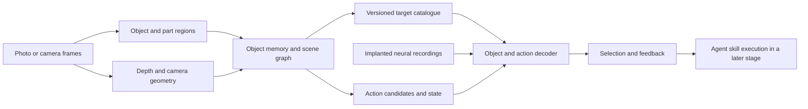

# Architecture of the object and action interface

The system has two main streams. Perception maintains the available targets and their context. Neural decoding estimates a user's choice against a versioned target set. The baseline implements the photo-to-menu path and a mouse-driven selection preview.

## Implemented path

`image → Grounding DINO boxes + Depth Anything V2 relative inverse depth → snapshot scene → category action suggestions → offline report`

The JSON contract is [scene.schema.json](../schemas/scene.schema.json). Objects contain clipped image boxes, normalized image centres, detector scores, an inner-box depth summary, and suggested actions. Coordinates in metres are `null`; the schema rejects invented metric positions in this version. Relations are empty because neither containment nor support is estimated yet.

The inner-box statistic reduces some boundary contamination but is not segmentation. Same-label overlapping boxes are suppressed; overlapping different labels remain because an object and a part can occupy overlapping regions. Conflicting labels and cross-prompt duplicates need a richer association step later.

## Planned persistent map

Separate four layers:

1. **Observations:** camera frame, timestamp, region, model revision, score, raw depth evidence.
2. **Objects and parts:** persistent session ID, parent link, fused geometry, label hypotheses, state, last observation time.
3. **Interaction candidates:** action, contact region, required state, required skill, feasibility evidence.
4. **Decoder view:** scene version, fixed target slots, object feature vectors, action vocabulary, and validity masks.

Store both camera and world coordinate conventions with transforms. Name a point by its meaning, such as visible-surface point or estimated object centre. Record whether scale came from a learned prior, a measured reference, or a depth sensor.

The map may update continuously while the decoder view remains fixed for a trial. If an object disappears or its identity becomes ambiguous, preserve the trial's identity and flag the observation as unavailable. Do not silently replace the object occupying that slot.

## Action evidence

A category rule, a language-model suggestion, a predicted contact point, and a verified agent skill are different evidence types. Keep them separate. A language model may expand candidate verbs in a slower discovery path; geometry, object state, and skill availability should determine what can actually be executed.

SayCan provides a useful precedent for combining language-level task relevance with skill-level affordance estimates. Its lesson here is the separation between describing a sensible action and establishing that an available controller can carry it out. [SayCan](https://say-can.github.io/)

## Timing and reproducibility

Each model run saves the effective configuration, model repository revisions, an input hash, package versions, and timing samples. The default config pins the exact model revisions from the first successful experiment. Update those pins deliberately when comparing a newer checkpoint. Preserve the original image bytes separately from the upright decoded-image hash.

The current file-creation timestamp is not an acquisition timestamp. Streaming work must add capture and neural time bases explicitly. The static output can be replayed as a fixture for later decoder integration without repeatedly running the vision models.

## Repository boundaries

Code, configurations, schemas, briefings, and small experiment records belong in Git. Raw scans and neural data live in ignored local folders. Model caches, downloaded upstream repositories, and generated reports also stay outside Git. Source records in `resources/` point to primary papers and official implementations; third-party code and weights retain their own terms.
