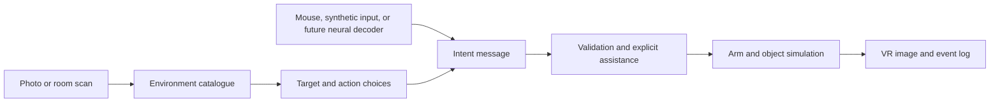

# A room simulation for target and motor control experiments

The first Unity environment uses an editable approximation of the living and dining room shown in the photo demo. The immediate purpose is to make the object/action interface spatial and interactive: choose a target, reach toward it with a virtual arm, and manipulate it. A desktop mode lets us verify the task before a headset is connected.

The environment uses stable authored target IDs rather than the detector's snapshot IDs. These identify simulation entities, not longitudinally tracked physical objects. Furniture positions and dimensions are provisional estimates from the image; experiment props are explicitly added to make repeatable reaching tasks possible. The [provenance record](../resources/room-proxy-provenance.json) distinguishes photo-based furniture from the added props.

Think of the scene as a laboratory task board in three dimensions. The mug has an ID and a location; the action menu says which operations the prototype implements; a decoder message says what was requested. The controller then decides whether the request can happen now. For example, a grasp is accepted only when the open hand is near a movable object. Opening a cupboard is simpler in this version: a symbolic command drives its hinge without requiring fingertip contact.

## Control boundary

All input sources use the same intent interface. Desktop controls, headset controllers, and an external decoder adapter submit commands to the simulation. The simulation validates the target, available action, sequence number, scene version, and command age before changing state. Continuous velocity input expires when updates stop.

A file adapter is sufficient for the first local demonstration. It avoids coupling the Unity task to an amplifier vendor or a particular neural streaming library. The adapter can later be replaced by an acquisition-compatible transport while preserving the task interface.

There are two useful timescales. Perception updates the environment catalogue, possibly before a trial begins. The motor loop updates the virtual arm many times per second. A slower room reconstruction therefore need not slow every displayed frame. If objects move during a trial, their updates will need a separately measured mapping and tracking loop.

## First task

The primary trial is a short reach and grasp of a prop on the dining table, followed by release at a marked destination. Other targets demonstrate pressing, switching, opening, and closing. The virtual hand and the robot arm share an endpoint controller so that task geometry can remain constant while embodiment changes.

The interaction log separates submitted input, accepted input, poses, virtual contact, release, and object-state changes. Automatic trial scoring and neural acquisition synchronization are next additions. This makes it possible to evaluate decoder outputs and autonomous assistance separately. Timestamps from the simulation are local application timestamps until a neural acquisition clock is explicitly synchronized.

Continuous motor control currently has three numbers: endpoint velocity along the room's X, Y, and Z axes. The hand's orientation is fixed, and grasp is a separate binary operation. The arm uses inverse kinematics: it chooses joint angles that place the hand at the requested point. Its robot appearance uses the same controller. This is sufficient to prototype target selection, shared control, and reach trajectories; robot dynamics and individual finger control require a richer embodiment model.

## VR verification

Desktop rendering and scripted task checks establish the operation of the simulator. The Android build has also been installed and tested for stereo rendering and USB command input. The first [experiment record](../experiments/2026-11-16-unity.md) keeps measured behavior separate from remaining wearer, optical-fit, and timing checks.

For the phone glasses, head orientation comes from Cardboard, while the task's hand is driven by the intent interface. Phone VR does not add positional head tracking or physical hand tracking. Gaze dwell is a convenient prototype input and should be logged separately from a neural decoder in future experiments. A better headset can replace the XR provider while retaining the task catalogue and intent messages.
